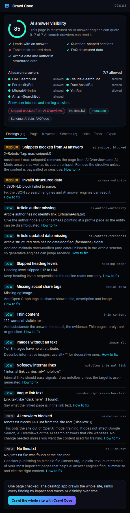

# SEO Chrome extension with an AI visibility check

An open-source SEO Chrome extension that audits the page you are on and also tells you whether AI answer engines can read and quote it: which AI crawlers robots.txt lets in, whether snippets are blocked from AI Overviews, whether the site has an llms.txt, and how extractable the page is for ChatGPT, Perplexity, Claude and Google AI Mode.

The checks, their names and their severities are the ones the [Crawl Cove](https://crawlcove.com/?utm_source=github&utm_medium=seo-chrome-extension) desktop crawler uses, so the popup is a one-page preview of the full site audit.



More: [Page](docs/screenshots/popup-page.png), [Keyword](docs/screenshots/popup-keyword.png), [Schema](docs/screenshots/popup-schema.png), [Links](docs/screenshots/popup-links.png), [Tools](docs/screenshots/popup-tools.png).

## What it shows

**AI answer visibility** (the part the big SEO toolbars do not check)

- **Extractability score, 0 to 100**: can a model lift a self-contained answer from this page? Scored on answer-first structure, question-shaped sections, FAQ markup, a table in structured data, and article date + author in structured data. Same formula (1.0.0) as the desktop app.
- **23 AI crawlers, allowed or blocked**, read from the site's robots.txt with the page's own path applied. Grouped by purpose, because the purposes differ: AI search crawlers (OAI-SearchBot, Claude-SearchBot, PerplexityBot…) decide whether you get cited; user fetchers (ChatGPT-User, Claude-User…) open a page when someone asks about it; training crawlers (GPTBot, ClaudeBot, Google-Extended…) are an opt-out choice, not a problem.
- **Snippet blocks**: `nosnippet` or `max-snippet:0` in the robots meta, the googlebot meta or the X-Robots-Tag header removes the page from AI Overviews and AI Mode as well as its search snippet.
- **llms.txt** present or missing.

**Findings**, high to info, each with the evidence and a "How to fix" link:

| AI | On-page |
|---|---|
| `ai-bot-access`, `ai-snippet-blocked`, `ai-llms-txt`, `ai-extractability`, `ai-answer-structure`, `ai-author-authority`, `ai-content-freshness`, `ai-entity-markup` | `title`, `title-length`, `meta-description`, `canonical`, `insecure-canonical`, `robots-noindex`, `heading-h1`, `heading-order`, `html-lang`, `viewport-missing`, `social-meta`, `structured-data-missing`, `schema-validity`, `thin-content`, `content-under-structured`, `hreflang`, `mixed-content`, `image-alt`, `lazy-loaded-first-image`, `nofollow-internal-link`, `non-descriptive-anchor-text` |

**Page**: a Google search preview with cut-off warnings, lab web vitals from this load (LCP, CLS, TTFB, DOMContentLoaded, weight, DOM size), title and description with lengths, canonical, robots directives from all three carriers, status, language, word count, heading outline (copyable), link and image counts, hreflang, Open Graph, structured data types.

**Keyword**: type a focus keyword and get a placement score: title (and how near the front), H1, meta description, opening paragraph, H2/H3, URL and body, with density and stuffing warnings. Below it, the two and three word phrases the page repeats most, so you can see what it is actually about before you decide what it should rank for.

**Schema**: every JSON-LD node by type, with the required and recommended properties from Google's rich result documentation and the missing ones named. Rich Results Test is one click away.

**Links**: every link with its text, internal or external, rel and target, filterable by nofollow; every image with alt, natural and displayed size, loading attribute and missing width/height. Copy or download either as CSV.

**Tools**: highlight headings, nofollow links, external links or images without alt on the page itself. Open the current URL in Google, Bing, PageSpeed Insights, Rich Results Test, the schema.org validator, the Wayback Machine or the W3C validator; jump to robots.txt, sitemap.xml and llms.txt; or run one of the Crawl Cove free tools.

**Export**: a Markdown report for a ticket or client note, or JSON whose page record follows the [Crawl Cove export spec](https://github.com/CrawlCove/seo-crawl-export-spec), so the [Sheets importer](https://github.com/CrawlCove/seo-audit-google-sheets), the [JS library](https://github.com/CrawlCove/seo-crawl-export-js) and the [MCP server](https://github.com/CrawlCove/seo-mcp-server) can read it.

## Install

Chrome Web Store listing: coming. Until then, from source:

1. Clone or [download](https://github.com/CrawlCove/seo-chrome-extension/archive/refs/heads/main.zip) this repository.
2. Open `chrome://extensions`, turn on **Developer mode**, press **Load unpacked** and pick the folder.
3. Pin the icon. Open any page and press it, or press Alt+Shift+C.

There is no build step: the repository is the extension. Works in Chrome, Edge, Brave and other Chromium browsers (Manifest V3, Chrome 116+).

## Privacy

Nothing leaves your browser. The only requests are three same-origin fetches (robots.txt, llms.txt, the page's own headers) made when you press the button. No account, no analytics. See [PRIVACY.md](PRIVACY.md).

## How the AI checks work

- `lib/aiBots.js` holds the crawler registry and a robots.txt parser with the same group, wildcard and longest-match rules the desktop app uses.
- `lib/extractability.js` is the scoring formula. Weights: answer-first 25, question-shaped sections 25, FAQ schema 20, table in structured data 15, article date + author in structured data 15. Below 50 the page is flagged `ai-extractability`.
- `lib/checks.js` runs every check against the page snapshot and the site probe, pure and testable in Node.

```sh
npm test                          # unit tests, node:test, no dependencies
node tests/browser/smoke.mjs      # real Chromium: content script + probe + popup render (needs playwright)
```

## Works with Crawl Cove

The extension checks one page. [Crawl Cove](https://crawlcove.com/?utm_source=github&utm_medium=seo-chrome-extension) crawls the whole site, tracks AI visibility from one crawl to the next, and ranks findings by impact once Search Console is connected. Press "Crawl the whole site" in the popup to go there.

## Related tools

- [seo-crawler-cli](https://github.com/CrawlCove/seo-crawler-cli): headless crawler for scripts, cron and CI
- [seo-audit-action](https://github.com/CrawlCove/seo-audit-action): fail a pull request on SEO regressions
- [seo-mcp-server](https://github.com/CrawlCove/seo-mcp-server): ask Claude or Cursor about your crawl
- [robots-txt-tester](https://github.com/CrawlCove/robots-txt-tester): the robots.txt logic as a CLI
- [schema-markup-validator](https://github.com/CrawlCove/schema-markup-validator), [hreflang-checker](https://github.com/CrawlCove/hreflang-checker), [redirect-chain-checker](https://github.com/CrawlCove/redirect-chain-checker), [xml-sitemap-validator](https://github.com/CrawlCove/xml-sitemap-validator)
- [seo-crawl-export-spec](https://github.com/CrawlCove/seo-crawl-export-spec): the export format this extension writes

MIT licensed.
